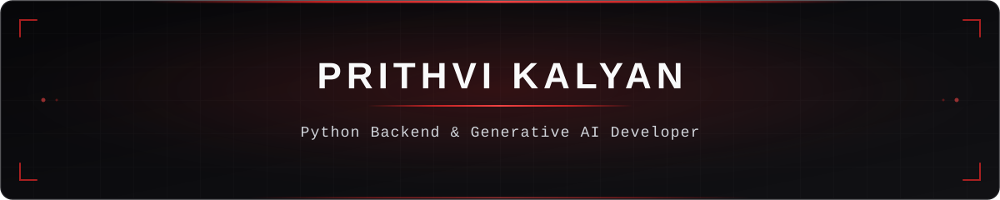

<!-- =====================================================
     GITHUB PROFILE README
     Prithvi Kalyan | Prithvikalyan
     Refined PDF-inspired dark & red developer portfolio
     ===================================================== -->

<!-- HEADER -->

  

  

  <a href="https://github.com/Prithvikalyan"><b>GitHub</b></a>
  &nbsp;&bull;&nbsp;
  <a href="https://www.linkedin.com/in/prithvikalyan/"><b>LinkedIn</b></a>
  &nbsp;&bull;&nbsp;
  <a href="mailto:prithvikalyan2002@gmail.com"><b>Email</b></a>

<!-- ABOUT ME -->

<h2 align="center">1. About Me</h2>

  

  

  Hey! I'm <b>Prithvi Kalyan</b>, a developer focused on
  <b>Python Backend Development and Generative AI</b>,
  based in Visakhapatnam, India.
   
  I enjoy building practical AI-powered applications using
  Python, FastAPI, REST APIs, Large Language Models,
  Agentic AI, Retrieval-Augmented Generation (RAG),
  embeddings, and semantic search.

  🟢 <b>Status:</b> Building &amp; Learning &nbsp;|&nbsp;
  <b>Focus:</b> Python Backend &amp; AI
   
  <b>Education:</b> MCA (Computer Applications) — Avanthi Institute of Engineering &amp; Technology
   
  <b>Location:</b> Visakhapatnam, India

  💬 <b>Let's Discuss:</b>
  Python, FastAPI, REST APIs, LLMs, Agentic AI,
  RAG, LangGraph, LangChain, Embeddings, and Vector Search.
   
  ⚡ <b>Philosophy:</b>
  "I enjoy turning ideas into practical software
  and continuously learning through building."

<table width="100%" border="0" align="center" cellpadding="12">
  <tr>
    <td width="50%" align="center">
      <h4>🔭 Flagship Project</h4>
      

        <a href="https://github.com/Prithvikalyan/TenderWise"><b>TenderWise</b></a>
         
        Advanced RAG &amp; Tender Intelligence
      

    </td>
    <td width="50%" align="center">
      <h4>🌱 Active Deep Dives</h4>
      

        <b>Agentic AI &amp; Advanced RAG</b>
         
        Reranking, BM25 &amp; LLM Evaluation
      

    </td>
  </tr>
  <tr>
    <td width="50%" align="center">
      <h4>🤖 AI Project Development</h4>
      

        <a href="https://github.com/Prithvikalyan/CodePilot"><b>CodePilot</b></a>
         
        AI Project Analyst Agent
      

    </td>
    <td width="50%" align="center">
      <h4>📚 Learning Assistant</h4>
      

        <a href="https://github.com/Prithvikalyan/SkillPilot"><b>SkillPilot</b></a>
         
        AI-Powered Personalized Learning
      

    </td>
  </tr>
</table>

<!-- FEATURED PROJECTS -->

<h2 align="center">2. Featured Projects</h2>

<table width="100%" border="0" align="center" cellpadding="16">
  <tr>
    <td align="center">
      <h3>1. TenderWise – Advanced RAG Document Intelligence</h3>
      

        An AI-powered government tender intelligence and
        bid-readiness platform designed to help teams analyze
        tender documents, understand bidder requirements,
        organize company evidence, and prepare for bid submission.
      

      

        <b>Tech Stack:</b> Python · FastAPI · PostgreSQL · pgvector ·
        RAG · LangGraph · Embeddings · Hybrid Retrieval
      

      

        
      

    </td>
  </tr>
  <tr>
    <td align="center">
      <h3>2. CodePilot – AI Project Analyst Agent</h3>
      

        An AI-powered project analyst that helps developers
        understand, explore, and review their codebases.
        It provides project explanations, architecture analysis,
        code reviews, structure analysis, and project reports
        using an AI-powered workflow.
      

      

        <b>Tech Stack:</b> Python · FastAPI · LangGraph · NVIDIA AI ·
        REST APIs · Pydantic
      

      

        
      

    </td>
  </tr>
  <tr>
    <td align="center">
      <h3>3. SkillPilot – AI-Powered Learning Assistant</h3>
      

        An AI-powered learning assistant designed to help
        students and beginners understand technical concepts,
        create personalized learning roadmaps, and maintain
        learning progress using LLMs, RAG, and semantic search.
      

      

        <b>Tech Stack:</b> Python · FastAPI · PostgreSQL · pgvector ·
        LLMs · RAG · Embeddings · Semantic Search
      

      

        
      

    </td>
  </tr>
</table>

<!-- TECH STACK -->

<h2 align="center">3. Tech Stack &amp; Skills</h2>

<b>Core Programming Languages</b>

  
   
  Python &middot; JavaScript

<b>Backend Development &amp; APIs</b>

  
   
  FastAPI &middot; REST APIs &middot; SQLAlchemy &middot; Pydantic

<b>Generative AI &amp; LLM Engineering</b>

  LLMs &middot; Agentic AI &middot; RAG &middot; LangGraph &middot;
  LangChain &middot; Embeddings &middot; Reranking &middot;
  Prompt Engineering &middot; Guardrails &middot; LLM Evaluation &middot; BM25

<b>Databases &amp; Vector Search</b>

  
   
  PostgreSQL &middot; SQLite &middot; pgvector

<b>Cloud Technologies – AWS</b>

  
   
  EC2 &middot; S3 &middot; IAM &middot; VPC &middot; Security Groups &middot;
  Route 53 &middot; CloudWatch &middot; AWS CLI

<b>Operating Systems &amp; DevOps</b>

  
   
  Linux &middot; Docker &middot; Git

<!-- GITHUB ANALYTICS -->

<h2 align="center">4. GitHub Analytics &amp; Activity</h2>

  
  

  

  

<!-- CONTRIBUTION JOURNEY -->

<h2 align="center">5. Contribution Journey</h2>

  

<!-- CONTACT -->

<h2 align="center">6. Let's Connect &amp; Collaborate</h2>

  Whether you want to discuss backend development,
  Generative AI, AI applications, or software projects —
  let's connect.

<table border="0" align="center" cellpadding="12">
  <tr>
    <td align="center" width="220">
      <a href="https://github.com/Prithvikalyan">
        
         
        <b>GitHub</b>
      </a>
       
      Developer Profile
    </td>
    <td align="center" width="220">
      <a href="https://www.linkedin.com/in/prithvikalyan/">
        
         
        <b>LinkedIn</b>
      </a>
       
      Professional Network
    </td>
    <td align="center" width="220">
      <a href="mailto:prithvikalyan2002@gmail.com">
        
         
        <b>Email</b>
      </a>
       
      Direct Contact
    </td>
  </tr>
</table>

  

  Building. Learning. Improving.

